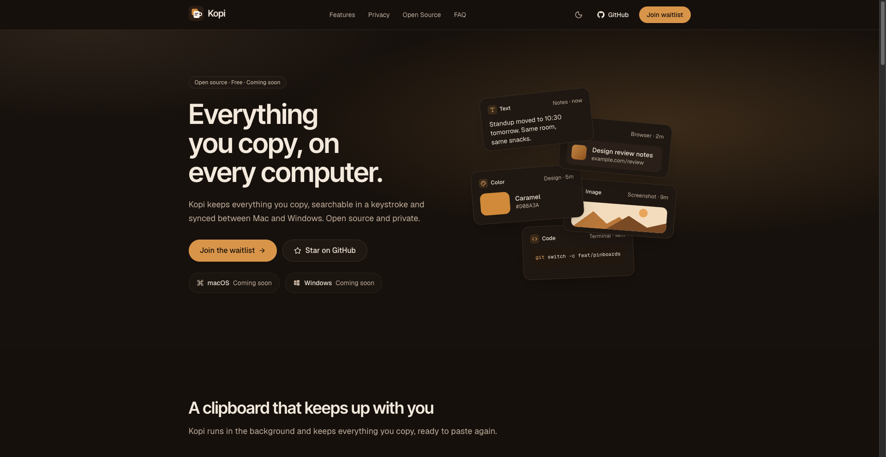

<div align="center">


# Kopi

**Everything you copy, on every computer.**

An open-source clipboard manager for macOS and Windows.

<p>
  
  <a href="LICENSE"></a>
  
  <a href="https://github.com/code-devanshu/kopi/actions/workflows/ci.yml"></a>
</p>

<p>
  <a href="https://kopi.devanshuverma.in"><strong>Website</strong></a> ·
  <a href="https://kopi.devanshuverma.in/#waitlist"><strong>Join the waitlist</strong></a> ·
  <a href="ROADMAP.md">Roadmap</a> ·
  <a href="CONTRIBUTING.md">Contributing</a>
</p>



</div>

<br />

> [!NOTE]
> Kopi is in the design stage. There's no app to download yet. This repo holds the website and an early scaffold of the desktop app in `apps/desktop`. Join the [waitlist](https://kopi.devanshuverma.in/#waitlist) to hear when the first alpha is ready.

## Planned features

- **Unlimited clipboard history** for text, links, images, colors and code.
- **Fast search** across everything you've copied, filtered by type or source app.
- **Pinboards** that keep the snippets you reuse one keystroke away.
- **Keyboard-first:** open, search and paste without touching the mouse.
- **Paste as plain text** when you don't want the formatting.
- **Private by default:** history is stored locally, works offline and needs no account. Copies from password managers are skipped.
- **Mac ↔ Windows sync** (planned): optional and end-to-end encrypted.

## Why Kopi

- **Open source.** You can read every line that touches your clipboard, and build it yourself if you'd rather.
- **Cross-platform.** One app with the same shortcuts and history on macOS and Windows, not two separate tools.
- **Private.** Your clipboard holds passwords, addresses and work you haven't shared yet. Kopi keeps it on your machine unless you turn on sync, and sync is encrypted before anything leaves your device.

## Roadmap

| Phase | Status |
| --- | --- |
| Website and waitlist | ✅ Done |
| Design and architecture | 🔨 In progress |
| macOS alpha | Planned |
| Windows alpha | Planned |
| Private beta | Planned |
| v1.0 public launch | Planned |
| Encrypted sync | Planned |

See [ROADMAP.md](ROADMAP.md) for what's in each phase. The planned technical design is in [docs/ARCHITECTURE.md](docs/ARCHITECTURE.md).

## Repository structure

```text
kopi/
├── apps/
│   ├── web/              # Website (Next.js): kopi.devanshuverma.in
│   └── desktop/          # Desktop app (Tauri, React): a scaffold so far
├── crates/
│   ├── kopi-core/        # Rust core, no Tauri
│   └── kopi-platform/    # OS APIs behind small traits
├── packages/             # Shared packages (empty for now)
├── docs/                 # Architecture notes and images
├── .github/              # Issue templates, PR template and CI
├── Cargo.toml            # Rust workspace
├── package.json          # Workspace scripts
└── pnpm-workspace.yaml
```

## Run the website locally

You need Node.js 20.9 or newer (CI uses Node 24) and pnpm. If you don't have pnpm, run `corepack enable`.

```bash
git clone https://github.com/code-devanshu/kopi.git
cd kopi
pnpm install
pnpm dev:web
```

Then open [http://localhost:3000](http://localhost:3000). The waitlist form works without any setup: in development it logs sign-ups to the browser console. See [apps/web/README.md](apps/web/README.md) for environment variables and more details.

| Command | What it does |
| --- | --- |
| `pnpm dev:web` | Start the website's dev server |
| `pnpm build:web` | Build the website |
| `pnpm dev:desktop` | Run the desktop app in development (needs Rust, see [apps/desktop/README.md](apps/desktop/README.md)) |
| `pnpm build:desktop` | Build `Kopi.app` |
| `pnpm build` | Build every package |
| `pnpm lint` | Lint every package |

## Contributing

Kopi is early, so it's a good time to have a say in how it turns out. Right now the most useful help is design, architecture discussion and work on the website. Read [CONTRIBUTING.md](CONTRIBUTING.md) to get started, and look for issues labelled [`good first issue`](https://github.com/code-devanshu/kopi/issues?q=is%3Aissue+is%3Aopen+label%3A%22good+first+issue%22).

Please follow the [Code of Conduct](CODE_OF_CONDUCT.md). To report a security issue, see [SECURITY.md](SECURITY.md) and don't open a public issue.

## License

Kopi is released under the [MIT License](LICENSE). The Kopi name and logo are not covered by the license; forks and redistributions must use a different name and logo.
