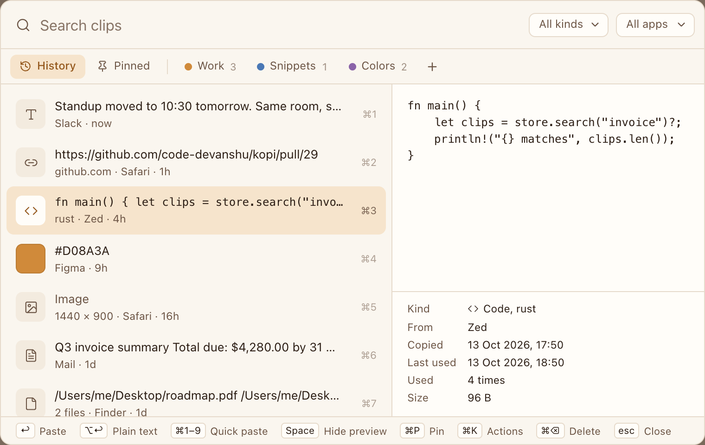

<div align="center">


# Kopi

**Everything you copy, on every computer.**

An open-source clipboard manager for macOS, with Windows next.

<p>
  <a href="https://github.com/code-devanshu/kopi/releases"></a>
  <a href="LICENSE"></a>
  
  <a href="https://github.com/code-devanshu/kopi/actions/workflows/ci.yml"></a>
</p>

<p>
  <a href="https://github.com/code-devanshu/kopi/releases"><strong>Download for macOS</strong></a> ·
  <a href="docs/INSTALL_ALPHA.md">Install guide</a> ·
  <a href="https://kopi.devanshuverma.in">Website</a> ·
  <a href="ROADMAP.md">Roadmap</a> ·
  <a href="CONTRIBUTING.md">Contributing</a>
</p>

<picture>
  <source media="(prefers-color-scheme: dark)" srcset="docs/images/panel-dark.png" />
  
</picture>

</div>

<br />

> [!NOTE]
> Kopi is in **alpha** on macOS. It's usable every day, but expect rough edges, and please [report what you find](https://github.com/code-devanshu/kopi/issues/new/choose). Windows comes next.

## Download

Kopi needs **macOS 14 Sonoma or later**, on Apple silicon or Intel.

1. Download `Kopi_<version>_universal.dmg` from the newest release on the [releases page](https://github.com/code-devanshu/kopi/releases).
2. Open it and drag **Kopi** onto **Applications**.
3. Open Kopi. **macOS blocks it the first time**, because Kopi isn't notarized: notarization needs a paid Apple developer account, and Kopi is free. On macOS 15 and later, click **Done**, then **Open Anyway** in **System Settings → Privacy & Security**. On macOS 14, Control-click Kopi in Applications and choose **Open**.

You do this once. Kopi installs its updates itself, and macOS doesn't block those. [docs/INSTALL_ALPHA.md](docs/INSTALL_ALPHA.md) walks through every step, the permissions Kopi asks for and how to remove it. The reasons behind not notarizing are in [ADR 0006](docs/decisions/0006-macos-distribution-without-notarization.md).

## What it does

Kopi lives in the menu bar. Press **⇧⌘V** in any app to open it.

- **History** of text, rich text, links, images, files, colors and code, with the app each copy came from.
- **Search** as you type, with filters by kind and app, and a preview of the selected clip.
- **Paste** into the app you're in with Return, as plain text with ⌥Return, or one of the first nine with ⌘1–9.
- **Pins and pinboards** for the snippets you reuse.
- **Keyboard-first:** open, search, preview and paste without touching the mouse.
- **Private by default:** history stays on your Mac, works offline and needs no account. Copies from password managers and content marked as concealed are skipped, and you can exclude any app.
- **History limits** by count, age and size. Pinned clips are kept.
- **Updates itself** from this repository's releases, with a switch to turn that off.

Planned: the Windows app, then optional end-to-end encrypted sync between your computers.

## Why Kopi

- **Open source.** You can read every line that touches your clipboard, and build it yourself if you'd rather.
- **Cross-platform.** One app with the same shortcuts and history on macOS and Windows, not two separate tools.
- **Private.** Your clipboard holds passwords, addresses and work you haven't shared yet. Kopi keeps it on your machine, and checking for updates sends nothing about you or your clips. How it's done is in [docs/PRIVACY_DESIGN.md](docs/PRIVACY_DESIGN.md).

## Roadmap

| Phase | Status |
| --- | --- |
| Website and waitlist | ✅ Done |
| Design and architecture | ✅ Done |
| macOS alpha | 🔨 Out now, improving |
| Windows alpha | Next |
| Private beta | Planned |
| v1.0 public launch | Planned |
| Encrypted sync | Planned |

See [ROADMAP.md](ROADMAP.md) for what's in each phase, and [CHANGELOG.md](CHANGELOG.md) for what changed in each release. The technical design is in [docs/ARCHITECTURE.md](docs/ARCHITECTURE.md).

## Build from source

You need macOS 14 or later, the Xcode Command Line Tools (`xcode-select --install`), Rust 1.90 or newer from [rustup](https://rustup.rs), Node.js 20.9 or newer and pnpm (`corepack enable`).

```bash
git clone https://github.com/code-devanshu/kopi.git
cd kopi
pnpm install
pnpm dev:desktop      # run Kopi in development
pnpm build:desktop    # build target/release/bundle/macos/Kopi.app
```

Quit an installed Kopi first: a second Kopi hands over to the one that's running and quits. A local build is signed ad hoc, so macOS asks for its permissions again after every rebuild. [apps/desktop/README.md](apps/desktop/README.md) has the details, and how to work on the UI in a browser.

| Command | What it does |
| --- | --- |
| `pnpm dev:desktop` | Run the desktop app in development |
| `pnpm build:desktop` | Build `Kopi.app` |
| `pnpm dev:web` | Start the website's dev server at [http://localhost:3000](http://localhost:3000) |
| `pnpm build:web` | Build the website |
| `pnpm build` | Build every package |
| `pnpm lint` | Lint every package |

The website needs no setup for development: the waitlist form logs sign-ups to the browser console. See [apps/web/README.md](apps/web/README.md).

## Repository structure

```text
kopi/
├── apps/
│   ├── desktop/          # Desktop app (Tauri 2, React)
│   └── web/              # Website (Next.js): kopi.devanshuverma.in
├── crates/
│   ├── kopi-core/        # Rust core: storage, search, capture, privacy filter. No Tauri.
│   └── kopi-platform/    # OS APIs behind small traits
├── docs/                 # Architecture, decisions, privacy design, install and release guides
├── .github/              # Issue templates, PR template, CI and release workflows
├── Cargo.toml            # Rust workspace
├── package.json          # Workspace scripts
└── pnpm-workspace.yaml
```

## Contributing

The most useful help right now is using the alpha and [reporting what breaks](https://github.com/code-devanshu/kopi/issues/new/choose), and work towards the Windows app. Read [CONTRIBUTING.md](CONTRIBUTING.md) to get started, and look for issues labelled [`good first issue`](https://github.com/code-devanshu/kopi/issues?q=is%3Aissue+is%3Aopen+label%3A%22good+first+issue%22).

Please follow the [Code of Conduct](CODE_OF_CONDUCT.md). To report a security issue, see [SECURITY.md](SECURITY.md) and don't open a public issue.

## License

Kopi is released under the [MIT License](LICENSE). The Kopi name and logo are not covered by the license; forks and redistributions must use a different name and logo.
