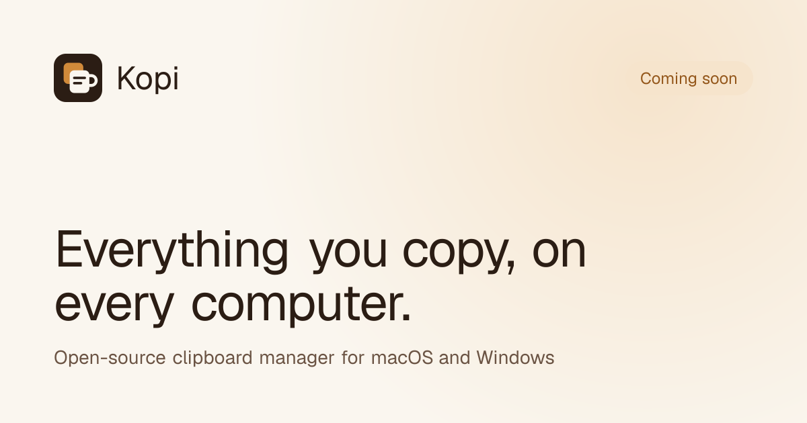

<div align="center">


# Kopi website

The home page for Kopi: the macOS download and a waitlist for Windows.<br />
<a href="https://kopi.devanshuverma.in"><strong>kopi.devanshuverma.in</strong></a> · <a href="../../README.md">About Kopi</a>

<p>
  
  
  
  
  
  <br />
  <a href="https://github.com/code-devanshu/kopi/stargazers"></a>
  <a href="https://github.com/code-devanshu/kopi/issues"></a>
  <a href="https://github.com/code-devanshu/kopi/commits/main"></a>
</p>

<p>
  <a href="https://kopi.devanshuverma.in">Website</a> ·
  <a href="#getting-started">Getting started</a> ·
  <a href="#before-you-launch">Before you launch</a> ·
  <a href="#deploying">Deploying</a>
</p>



</div>

<br />

> [!NOTE]
> The download buttons link to [GitHub Releases](https://github.com/code-devanshu/kopi/releases), not to a file, so the site doesn't change with every alpha. The waitlist form is how people sign up to hear about the Windows alpha or to help build Kopi. For what Kopi does, see the [root README](../../README.md).

## About this website

It's a single page built with the Next.js App Router. It includes:

- **Sticky navigation** with a light/dark toggle. The theme follows your system until you choose one.
- **Hero** with a stack of clipboard cards that fans out on load, the macOS download and a note on Windows.
- **Feature grid** of six cards, each with its own small animation.
- **Sync demo**: a clip copied in a Mac window travels to a Windows window.
- **Privacy, use-case tabs** (Developers, Designers, Writers, Students) and a **roadmap**.
- **Open source** call for contributors, a **waitlist form** and an **FAQ** accordion.

All the product visuals are drawn in SVG and CSS. There are no screenshots, no video and no 3D libraries.

**Accessibility and motion.** The page uses semantic landmarks, labelled form fields, visible focus rings and keyboard-operable tabs and accordions, and its colors meet contrast guidelines. When `prefers-reduced-motion` is set, the looping animations stop and entrance animations are reduced.

**SEO.** Metadata, Open Graph and Twitter cards, a generated OG image, a favicon made from the logo, `sitemap.xml` and `robots.txt` are all included.

## Tech stack

| Area | Choice |
| --- | --- |
| Framework | [Next.js 16](https://nextjs.org) (App Router, Turbopack) |
| Language | TypeScript |
| Styling | Tailwind CSS v4, with design tokens as CSS variables |
| Animation | [Motion](https://motion.dev) |
| Icons | [Lucide](https://lucide.dev), plus inline SVG for brand marks |
| Forms | React Hook Form and Zod, with email delivery by [Web3Forms](https://web3forms.com) and spam protection by [hCaptcha](https://www.hcaptcha.com) |
| Fonts | Inter Tight (headings), Geist (body) and Geist Mono, loaded with `next/font` |

## Getting started

**Prerequisites:** Node.js 20.9 or newer, and pnpm (run `corepack enable` if you don't have it).

This site is the `@kopi/web` package in a pnpm workspace. Install from the repository root:

```bash
git clone https://github.com/code-devanshu/kopi.git
cd kopi
pnpm install
pnpm dev:web
```

Then open [http://localhost:3000](http://localhost:3000).

### Scripts

Run these from the repository root. Inside `apps/web`, `pnpm dev`, `pnpm build`, `pnpm start` and `pnpm lint` do the same.

| Command | What it does |
| --- | --- |
| `pnpm dev:web` | Start the dev server with hot reload |
| `pnpm build:web` | Create a production build |
| `pnpm --filter @kopi/web start` | Serve the production build (run `build:web` first) |
| `pnpm --filter @kopi/web lint` | Run ESLint on the website only |

### Environment variables

Copy [`.env.example`](.env.example) to `.env.local` in `apps/web`. Next.js reads env files from this folder, not from the repository root:

```bash
# The public URL of the site. Used for canonical links, Open Graph, the sitemap and robots.txt.
NEXT_PUBLIC_SITE_URL=https://kopi.devanshuverma.in

# Web3Forms access key. Waitlist sign-ups are emailed to the inbox it was created for.
NEXT_PUBLIC_WEB3FORMS_KEY=your-access-key

# Google Analytics 4 measurement ID.
NEXT_PUBLIC_GA_ID=G-Y2J68GL859
```

If `NEXT_PUBLIC_SITE_URL` isn't set, the site uses `https://kopi.devanshuverma.in`. Set it only if you deploy somewhere else. `NEXT_PUBLIC_GA_ID` falls back to `G-Y2J68GL859` in the same way.

## Before you launch

> [!IMPORTANT]
> A few things are placeholders until a real home and provider are chosen.

- [ ] **Links:** set the X and contact links in [`src/lib/site.ts`](src/lib/site.ts).
- [x] **Site URL:** live at [kopi.devanshuverma.in](https://kopi.devanshuverma.in).
- [ ] **Waitlist email:** set `NEXT_PUBLIC_WEB3FORMS_KEY` (see below).
- [ ] **Roadmap:** update the stage statuses in [`src/components/roadmap.tsx`](src/components/roadmap.tsx) as work moves along.
- [ ] **Privacy:** add a privacy policy page and point the footer link at it.
- [x] **License:** MIT, in [`LICENSE`](../../LICENSE) at the repository root.

### Connecting the waitlist

Each sign-up is emailed to you through [Web3Forms](https://web3forms.com), so the site needs no backend. Replying to the email goes straight to the person who signed up.

1. Go to [web3forms.com](https://web3forms.com), enter the address that should receive sign-ups and copy the access key it emails you.
2. Add it to `.env.local`, and to your host's environment variables when you deploy:

   ```bash
   NEXT_PUBLIC_WEB3FORMS_KEY=your-access-key
   ```

3. In the [Web3Forms dashboard](https://app.web3forms.com), open the form's settings and turn on hCaptcha as its spam protection. Web3Forms then rejects any submission without a valid captcha token, including ones sent straight to its API.

The form validates input with Zod, asks for an hCaptcha check and filters simple bots with a hidden honeypot field, then posts from the browser in [`src/lib/waitlist.ts`](src/lib/waitlist.ts). The key is safe to expose, since it can only send mail to your inbox. The hCaptcha widget uses the shared site key from Web3Forms' free plan, set in [`src/components/waitlist/waitlist-captcha.tsx`](src/components/waitlist/waitlist-captcha.tsx), so there's no hCaptcha account or secret to manage. If it isn't set, `pnpm dev:web` logs sign-ups to the browser console and a production build shows an error. To use a different provider later, change only that file.

## Project structure

<details>
<summary>Show the tree</summary>

```text
src/
├── app/
│   ├── globals.css             # Color tokens, light/dark themes, hero grain
│   ├── icon.svg                # Favicon (the logo mark)
│   ├── layout.tsx              # Fonts, metadata, theme script, analytics
│   ├── opengraph-image.tsx     # Generated social preview card
│   ├── page.tsx                # Assembles the page sections
│   ├── robots.ts
│   └── sitemap.ts
├── components/
│   ├── analytics/              # GA4 tag (production only) and click tracking
│   ├── brand/                  # Logo and inline brand icons
│   ├── features/               # Feature grid and its mini animations
│   ├── hero/                   # Hero, card stack, disabled download buttons
│   ├── sync/                   # Mac → Windows sync demo
│   ├── theme/                  # No-flash theme script and toggle
│   ├── ui/                     # Section layout, reveal-on-scroll, button styles
│   ├── use-cases/              # "Built for how you work" tabs
│   ├── waitlist/               # Form, fields, hCaptcha, success state
│   ├── faq.tsx
│   ├── motion-provider.tsx     # Shared Motion settings, including reduced motion
│   ├── open-source.tsx
│   ├── privacy-section.tsx
│   ├── roadmap.tsx
│   ├── site-footer.tsx
│   └── site-nav.tsx
└── lib/
    ├── analytics.ts            # GA4 ID and trackEvent()
    ├── cn.ts                   # Joins class names
    ├── site.ts                 # Site name, URL and external links
    ├── waitlist-schema.ts      # Shared Zod schema and options
    └── waitlist.ts             # Sends sign-ups to Web3Forms
```

</details>

### Analytics

Google Analytics 4 loads only in production builds, and it sends nothing when the site runs on localhost. To track a click on any element, including in server components, add `data-track="event_name"`. Each `data-track-foo="bar"` attribute on the element becomes the event parameter `foo`. In client code, call `trackEvent(name, params)` from [`src/lib/analytics.ts`](src/lib/analytics.ts). If GA hasn't loaded, nothing is sent. Never put personal data such as emails, names or message text in event parameters.

### Theming

All colors are CSS variables in [`src/app/globals.css`](src/app/globals.css) and are exposed to Tailwind as tokens such as `bg-background`, `text-foreground`, `bg-accent` and `text-accent-text`. Light mode uses cream and espresso, dark mode uses roasted brown and cream, and both share a caramel accent. To change the palette, edit the variables. The components don't need to change.

## Deploying

This is a standard Next.js app inside a pnpm workspace.

- **Vercel:** set the project's Root Directory to `apps/web`. Vercel installs from the workspace root using `pnpm-lock.yaml`.
- **Other hosts:** run `pnpm install && pnpm build:web` from the root, then `pnpm --filter @kopi/web start`.

Remember to set `NEXT_PUBLIC_WEB3FORMS_KEY`, and `NEXT_PUBLIC_SITE_URL` if the domain differs.

## Contributing

See [CONTRIBUTING.md](../../CONTRIBUTING.md). Kopi is released under the [MIT License](../../LICENSE).

<div align="center">
<br />
<sub>© 2026 Kopi. Brewing now.</sub>
</div>
