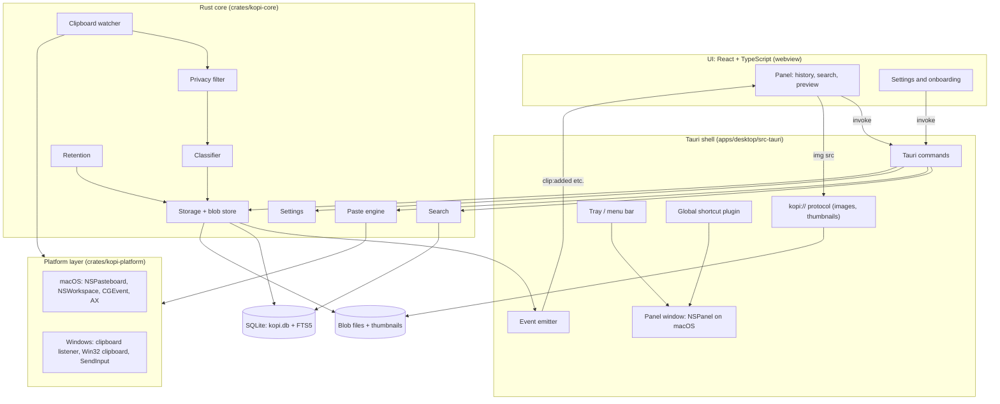
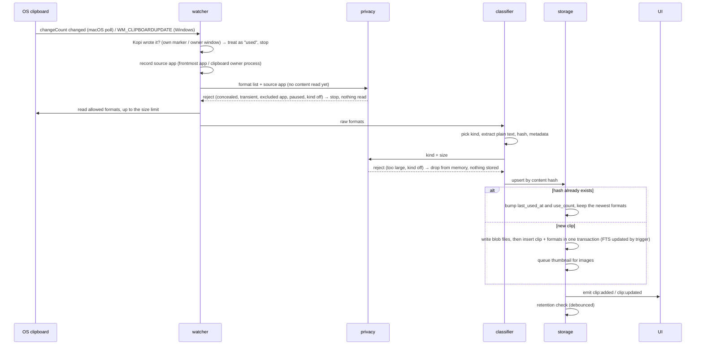

# Architecture

> [!NOTE]
> Kopi is being built. On macOS the desktop app captures copies and has the panel with history, search, preview, paste, pins and pinboards, a Settings window and first-run onboarding. This document describes the design for the macOS alpha. It will change as the spikes in [ISSUES_TO_CREATE.md](ISSUES_TO_CREATE.md) report back. To comment, open a [discussion](https://github.com/code-devanshu/kopi/discussions) or a pull request against this file.

Related docs:

- [DATA_MODEL.md](DATA_MODEL.md): SQLite schema, search, storage on disk and retention
- [PLATFORM_NOTES.md](PLATFORM_NOTES.md): macOS, Windows and Tauri research, with sources
- [PRIVACY_DESIGN.md](PRIVACY_DESIGN.md): what Kopi never stores, and the user controls
- [MVP_SCOPE.md](MVP_SCOPE.md): what's in the macOS alpha, and what isn't
- [decisions/](decisions/): Architecture Decision Records (ADRs)

## Goals

- **Fast.** The panel opens instantly from a hotkey, and search keeps up as you type, even with 100,000+ clips.
- **Light.** Kopi runs all day, so it should use little memory and almost no CPU when idle.
- **Private.** Clipboard data stays on the device. Sensitive copies are never read, let alone stored.
- **Native-feeling.** It follows macOS conventions on Mac (and Windows conventions on Windows), rather than feeling like a web page in a box.

## Stack

| Layer | Choice | Version at time of writing |
| --- | --- | --- |
| App shell | [Tauri v2](https://v2.tauri.app) ([ADR 0001](decisions/0001-use-tauri-v2.md)) | `tauri` 2.12.x |
| Core | Rust, split into crates that can be tested without Tauri | Rust 1.90+ (Tauri's MSRV) |
| UI | React and TypeScript, built with Vite | React 19 |
| Storage | SQLite with FTS5, through `rusqlite` with bundled SQLite ([ADR 0002](decisions/0002-sqlite-fts5-storage.md)) | `rusqlite` 0.40, SQLite 3.54 |
| Platform APIs | `objc2-app-kit` on macOS and `windows` on Windows ([ADR 0003](decisions/0003-clipboard-watching-approach.md)) | 0.3 / 0.62 |

## Overview



Rules that keep this simple:

- The UI never touches the clipboard, the database or the file system. It only calls Tauri commands and listens for events. We don't use `tauri-plugin-sql` or `tauri-plugin-clipboard-manager` from the frontend, because both would hand the webview direct access to clipboard data or SQL.
- Only the platform layer calls OS APIs. Everything above it works with plain Rust types, so it can be unit-tested on any OS.
- Binary data (images, file icons, thumbnails) goes to the UI through a custom `kopi://` URI scheme rather than as base64 over IPC.

## Rust crates and modules

The Rust code is a Cargo workspace, so the core can be built and tested without Tauri or a webview.

| Crate | Depends on Tauri? | Contents |
| --- | --- | --- |
| `crates/kopi-platform` | No | The OS traits, plus one implementation each for macOS and Windows |
| `crates/kopi-core` | No | Watcher loop, privacy filter, classifier, storage, search, paste engine, settings, retention |
| `apps/desktop/src-tauri` | Yes | App shell: commands, events, windows, tray, hotkeys, permissions UI glue |

### Platform layer (`kopi-platform`)

A small set of traits, with `macos` and `windows` modules behind `cfg(target_os)`:

```rust
trait Pasteboard {
    fn change_count(&self) -> Result<u64>;               // cheap, no content read
    fn types(&self) -> Result<PasteboardTypes>;          // format names per item, no content
    // Formats per item. Refuses without the grant, and fails if the change count moved.
    fn read(&self, change_count: u64, formats: &[Vec<String>], max_bytes: u64) -> Result<Vec<RawFormat>>;
    fn access(&self) -> Result<PasteboardAccess>;        // macOS 15.4+: default/ask/allow/deny
    // Replaces the contents. `source` marks the write as Kopi's, so the watcher skips it.
    fn write(&self, formats: &[RawFormat], source: Option<&str>) -> Result<u64>;
}
trait ForegroundApp { fn current(&self) -> Option<AppRef>; fn running(&self, bundle_id: &str) -> Option<AppRef>; }
trait UserIdle      { fn idle_time(&self) -> Option<Duration>; }  // slows polling when idle
trait KeySender     { fn send_paste(&self) -> Result<()>; }        // Cmd+V or Ctrl+V
trait Permissions   { fn is_granted(&self, p: Permission) -> bool; fn request(&self, p: Permission); fn open_settings(&self, p: Permission); }
```

All of them exist on macOS. The Windows versions arrive with the Windows alpha. On macOS every AppKit call runs on the main thread: from another thread it's queued on the main queue and waited for, with a 5 s limit so a thread being joined from the main thread can't deadlock with it.

On Windows, change notifications are pushed (`WM_CLIPBOARDUPDATE`). On macOS the watcher polls `change_count()`. Both feed the same channel in the core.

### Core modules (`kopi-core`)

| Module | Responsibility |
| --- | --- |
| `watcher` | Runs on its own thread. Detects clipboard changes, ignores changes Kopi made itself, records the source app, and passes the change to the privacy filter. Polling interval and backoff live here (macOS: 250 ms while active, 500 ms after 60 s of no input, so capture always stays within the alpha's 0.5 s target; to be tuned in the spike). |
| `privacy` | Two stages. Before any read, it decides from the format list and source app alone: concealed, transient and auto-generated markers, the Windows exclusion formats, excluded apps, paused state, and kinds turned off that the format list already rules out. After the read, in memory, it drops content over the size limit or of a kind turned off that only the content reveals (link, code, color). See [PRIVACY_DESIGN.md](PRIVACY_DESIGN.md). |
| `classifier` | Turns raw formats into a clip: picks the kind (`text`, `rich_text`, `link`, `image`, `file`, `color`, `code`), extracts the plain text, computes the content hash and metadata. `save` then runs the privacy filter's second stage and upserts the clip. See [DATA_MODEL.md](DATA_MODEL.md). |
| `storage` | Owns the SQLite connection pool (WAL mode, one writer thread), migrations, the content-addressed blob store and thumbnail generation. Upserts by content hash so repeated copies move to the top. |
| `search` | Builds FTS5 queries from the search box (with a `LIKE` fallback for 1–2 character words), applies filters (kind, source app, pinboard), ranks the newest matches by length and recency, pages results and returns snippets. See [DATA_MODEL.md](DATA_MODEL.md#full-text-search-fts5). |
| `paste` | Writes a clip back to the clipboard (all stored formats, or plain text only), returns focus to the target app and sends the paste keystroke through `KeySender`. Falls back to "copied, press ⌘V" when paste permission is missing. |
| `settings` | Typed settings with defaults, stored in the `settings` table: the shortcut, the kinds to capture, the theme and whether onboarding is done. The history limits are with `retention`. The app shell applies a change where it's used: the shortcut plugin, the privacy filter, the windows. |
| `retention` | Applies history limits (count, age, total size) on its own thread, never touches pinned or pinboard clips, and sweeps orphaned blob and thumbnail files at startup. The queries live in `storage`. |

### App shell (`src-tauri`)

| Area | Notes |
| --- | --- |
| Hotkeys | `tauri-plugin-global-shortcut`. The default shortcut is ⇧⌘V on macOS. It can be changed in Settings, which turns it off while recording a new one. A shortcut needs ⌘, ⌃ or ⌥. If the new one can't be registered, the old one stays. |
| Settings window | An ordinary window (`settings.html`), built when it's opened from the tray or with ⌘, in the panel, and destroyed when it's closed. Opening it hides the panel. |
| Onboarding window | An ordinary window (`onboarding.html`) in four steps: welcome, the permissions that are missing, the shortcut and launch at login, and done. It opens at launch until the user finishes or closes it, and from the tray's Set Up Kopi after that. The permissions step is skipped when nothing is missing. |
| Panel window | Borderless, always on top, hidden from the Dock and app switcher, hides when it loses focus. On macOS it's converted to a non-activating `NSPanel` with `tauri-nspanel`, so it can appear over full-screen apps without activating Kopi. See [PLATFORM_NOTES.md](PLATFORM_NOTES.md#panel-window). |
| Tray | Tauri's `tray-icon` feature. Menu: open Kopi, clear the last hour or day, settings, set up Kopi (onboarding), quit. Later: pause capture. On macOS the activation policy is `Accessory` and Info.plist sets `LSUIElement`, so there's no Dock icon, not even a flash at launch. |
| Other plugins | `autostart` (launch at login, a LaunchAgent for now: see [PLATFORM_NOTES.md](PLATFORM_NOTES.md#official-plugins)), `single-instance`. Later: `window-state` for Settings, `log`, `updater`. |
| Commands | `search_clips`, `get_clip`, `source_apps`, `paste_clip`, `copy_clip`, `delete_clips`, `hide_panel`, `set_pinned`, `pinboard_*`, `history_limits`, `set_history_limits`, `clear_history`, `get_settings`, `set_shortcut`, `suspend_shortcut`, `set_capture_kinds`, `set_theme`, `excluded_apps`, `add_excluded_app`, `remove_excluded_app`, `running_apps`, `launch_at_login`, `set_launch_at_login`, `permission_status`, `request_permission`, `open_permission_settings`, `open_settings`, `finish_onboarding`, `open_privacy_design`. Later: `set_paused` |
| Events | `clip:added`, `clip:updated`, `clip:removed`, `pinboards:changed`, `thumbnail:ready`, `theme:changed`, `panel:shown`, `panel:hidden`. Later: `capture:paused` |

## Data flow: something is copied



Key points:

- **The content is read only after the privacy filter passes.** The first stage looks at format names and the source app, not the data. The second stage sees the kind and size the classifier worked out, and drops failing content before anything is stored.
- **Own writes are ignored.** When Kopi pastes, it marks the clipboard (`org.nspasteboard.source` set to Kopi's bundle ID on macOS; on Windows the clipboard owner is Kopi's own window). The watcher counts that as a use of the existing clip, not a new copy.
- **Files are written before the database transaction.** A crash in between leaves an orphaned file, which retention sweeps. It never leaves a row pointing at a missing file.

## Data flow: something is pasted

```mermaid
sequenceDiagram
    participant U as User
    participant H as hotkey
    participant Panel
    participant PE as paste engine
    participant OS
    participant T as target app

    U->>H: ⇧⌘V
    H->>PE: remember target app (frontmost app)
    H->>Panel: show (non-activating panel on macOS; target app stays active)
    U->>Panel: search, choose clip, press Return (⌥Return = plain text)
    Panel->>PE: paste_clip(id, plain_text?)
    PE->>OS: write clip formats to clipboard, marked as Kopi's
    PE->>Panel: hide
    PE->>OS: return focus to target (macOS: usually a no-op; Windows: SetForegroundWindow)
    alt paste permission granted
        PE->>OS: post ⌘V (CGEvent) / Ctrl+V (SendInput)
        OS->>T: paste
    else permission missing
        PE->>Panel: toast: "Copied. Press ⌘V to paste."
    end
    PE->>PE: bump last_used_at and use_count
```

Notes:

- On macOS the panel doesn't activate Kopi, so the target app stays frontmost and only a short delay is needed before ⌘V. If the target isn't frontmost after about 150 ms, the paste engine gives up and leaves the clip on the clipboard.
- The V key code is looked up for the current keyboard layout. Layouts such as Dvorak and "Dvorak – QWERTY ⌘" move the key, and Maccy hit exactly this bug.
- Restoring the previous clipboard contents after a paste is out of scope for the alpha.

## Planned folder structure

```text
kopi/
├── Cargo.toml                 # Rust workspace: crates/* and apps/desktop/src-tauri
├── apps/
│   ├── web/                   # Website (exists)
│   └── desktop/               # @kopi/desktop
│       ├── package.json
│       ├── index.html         # the panel
│       ├── settings.html      # the Settings window
│       ├── onboarding.html    # the onboarding window
│       ├── vite.config.ts
│       ├── src/               # React UI
│       │   ├── main.tsx       # an entry per page: main.tsx, settings.tsx, onboarding.tsx
│       │   ├── windows/       # panel/, settings/, onboarding/: one entry per window
│       │   ├── features/      # history/, search/, pinboards/, preview/, settings/
│       │   ├── components/    # shared UI
│       │   ├── lib/ipc.ts     # typed wrappers around invoke() and listen()
│       │   └── styles/
│       └── src-tauri/
│           ├── Cargo.toml
│           ├── tauri.conf.json
│           ├── capabilities/  # Tauri permissions per window
│           ├── icons/
│           ├── Info.plist     # LSUIElement, usage descriptions
│           └── src/
│               ├── main.rs
│               ├── lib.rs     # builder, plugins, setup
│               ├── commands/  # thin wrappers that call kopi-core
│               ├── events.rs
│               ├── panel.rs   # window/NSPanel setup, show/hide
│               ├── settings_window.rs
│               ├── onboarding.rs
│               ├── tray.rs
│               ├── hotkeys.rs
│               └── protocol.rs  # kopi:// handler for blobs and thumbnails
├── crates/
│   ├── kopi-core/             # watcher, privacy, classifier, storage, search, paste, settings, retention
│   │   ├── src/
│   │   ├── migrations/        # 0001_init.sql, ...
│   │   └── tests/
│   └── kopi-platform/
│       └── src/{lib.rs, macos/, windows/}
└── packages/                  # Shared JS packages (none yet)
```

TypeScript bindings for the commands and their types are generated from the Rust code with [`tauri-specta`](https://github.com/specta-rs/tauri-specta), so the UI and the core can't drift apart. Dev builds and `cargo test -p kopi-desktop` write them to `apps/desktop/src/lib/bindings.ts`, and CI fails if the committed file is out of date. We chose it over `ts-rs` because it also generates typed wrappers for the commands and events, not just the types. The UI calls commands through `src/lib/ipc.ts`.

## Permissions on macOS

| Permission | Why | When it's requested |
| --- | --- | --- |
| Paste from Other Apps (pasteboard privacy) | Reading the clipboard in the background. On macOS versions that enforce it, every read would otherwise prompt. | Onboarding, with an explanation. The step is skipped where macOS doesn't ask. |
| Accessibility | Posting ⌘V into the target app | Onboarding (optional step). Without it, Kopi copies and the user presses ⌘V. |

Kopi needs no other permission. Global shortcuts registered with the Carbon hot key API don't need Input Monitoring. See [PLATFORM_NOTES.md](PLATFORM_NOTES.md) for details and the open questions on macOS 27.2.

## Open questions

These are the questions still open after this round of research. Comments and pull requests are welcome.

1. **Pasteboard privacy on macOS 27.2+.** Does reading `changeCount` or `types` trigger the alert? Does an app that's set to "Allow" stay allowed across updates, and do ad-hoc-signed dev builds lose it on every rebuild? This blocks the watcher design. It's the first spike.
2. **Encryption at rest.** Is FileVault enough, or should we use SQLCipher with a key in the Keychain? This is deferred until after the alpha, see [PRIVACY_DESIGN.md](PRIVACY_DESIGN.md).
3. **Code detection.** How cheap and accurate can the heuristic be? Should the user be able to change a clip's kind?
4. **Distribution.** Decided for macOS in [ADR 0006](decisions/0006-macos-distribution-without-notarization.md): no paid Apple Developer Program, so no notarization. Releases are signed with a self-signed certificate so permissions survive updates, and testers approve the first open in System Settings ([RELEASING.md](RELEASING.md)). The Mac App Store is out because of sandboxing and Accessibility. On Windows, SmartScreen reputation and the signing route are still open, see [PLATFORM_NOTES.md](PLATFORM_NOTES.md#code-signing-and-smartscreen).
5. **Shared design tokens.** Should the website and the app share colors and type through a package in `packages/`?
6. **Linux.** Out of scope, but the platform traits shouldn't rule it out.
