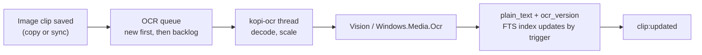

# Text in images (OCR) design

> [!NOTE]
> **Status: built on macOS,** for 0.1.0-alpha.11. Windows is next (see [Building it](#building-it)). [ADR 0009](decisions/0009-text-in-images.md) records the decisions. To comment, open a [discussion](https://github.com/code-devanshu/kopi/discussions) or a pull request against this file.

Kopi keeps every image the user copies, but search can't find them: an image clip has no text, so the only way back to last week's screenshot of an error message is scrolling. With this feature, Kopi reads the text in each copied image, on the computer, with the OS's own text recognition, and puts it where search already looks. Typing a few letters of the error then finds the screenshot.

Related docs: [DATA_MODEL.md](DATA_MODEL.md), [SYNC_DESIGN.md](SYNC_DESIGN.md), [PRIVACY_DESIGN.md](PRIVACY_DESIGN.md), [ARCHITECTURE.md](ARCHITECTURE.md).

## Goals

- **Search finds text in images**, with the search box, filters and ranking that already exist. No new screen to learn.
- **On the computer only.** Recognition uses Vision on macOS and `Windows.Media.Ocr` on Windows. No image or text leaves the computer, and nothing is downloaded.
- **Never slows copying down.** Text is read on a background thread after the clip is saved. Copying and the panel work as now while it runs.
- **Older images too.** Images already in the history are read once, in the background, newest first.
- **No new permission** and no new dependency on a model or service.
- **Easy to turn off,** in Settings → Capture, which also removes the text it read.

## Not goals (for this version)

- **Handwriting.** Both engines read printed text best. Whatever they find in handwriting is kept, but it isn't tested or promised.
- **Text in files**, such as PDFs or Word documents copied in Finder or Explorer. File clips are paths, and Kopi doesn't open the files.
- **Barcodes and QR codes.** Vision can read them, and copying the link in a QR code is a good idea for later.
- **Choosing languages** in Settings. Each OS's own language settings decide (see [Languages](#languages)).
- **Editing the recognized text** or correcting mistakes.
- **Reading text in other computers' images on their behalf.** Each computer reads its own (see [Sync](#sync)).

## What the user sees

### Search

Nothing changes until the user types. Image rows look as they do now: the thumbnail, "Image", and the size.

With a search, an image whose text matches appears in the results like any clip, ranked the same way. Its row keeps the thumbnail and shows the matched text in place of "Image", with the match marked, as text rows do. The **Images** filter narrows the results to images, so "Images" plus `invoice` finds the screenshot of an invoice.

Search can find an image only once its text has been read. For a new copy that's usually under a second. For the older history it's as fast as the [backlog](#older-images) gets through it.

### The preview

Below the image, a **Text in image** section shows the text Kopi read, in a small scrolling box, with a **Copy text** button.

- The text can be selected, so part of it can be copied with ⌘C.
- **Copy text** puts all of it on the clipboard as plain text, marked as Kopi's own write, so it doesn't become a new clip. The image stays where it is in the history.
- While the image is waiting to be read, the section says "Looking for text…". When no text was found, the section isn't shown.
- With **Find text in images** off, the section isn't shown.

### The clip menu

The clip menu (⌘K) for an image with text gains **Copy Text in Image**, which does the same as the button.

Paste is unchanged. Return pastes the image, and ⌥Return (plain text) also pastes the image, as now. An image's recognized text is never written to the clipboard except through **Copy text** (see [Paste](#paste)).

### Settings

**Settings → Capture** gains one switch, under the kinds to capture:

> **Find text in images** (on)
> Kopi reads the text in images you copy, on this computer, so search can find them. Nothing is sent anywhere.

- While the backlog runs, a line under it says "Reading older images: 1,240 left". When it's done, the line goes away.
- Turning it **off** stops reading and removes the text it read from this computer, so search stops finding images. Turning it on again reads them all again.
- With **Images** unticked in the kinds to capture, the switch is still available, for the images already in the history.
- On Windows, when no language on the computer has text recognition installed, the switch is off and greyed out with "Add a language with Optical character recognition in Windows Settings → Time & language." and a button that opens that page. Kopi checks again each time Settings opens.

It's **on by default**, for new users and for people updating, because it adds no permission and sends nothing anywhere. The release notes for 0.1.0-alpha.11 say that older images are read once after the update and how to turn it off.

## How it works



### The platform layer

`kopi-platform` gains a trait:

```rust
trait TextRecognizer {
    /// Whether recognition can run here: false on Windows without an OCR language.
    fn available(&self) -> bool;
    /// The largest edge it takes, in pixels. Larger images are scaled down first.
    fn max_dimension(&self) -> u32;
    /// The text in an image, as lines in reading order. Empty when there's none.
    fn recognize(&self, image: &RgbaImage) -> Result<Vec<String>, OcrError>;
}
```

`RgbaImage` is plain width, height and RGBA8 pixels, so `kopi-platform` doesn't decode anything.

- **macOS:** `VNRecognizeTextRequest` from Vision, through `objc2-vision`. The pixels become a `CGImage` (`objc2-core-graphics`), handed to `VNImageRequestHandler`. Settings: `recognitionLevel = .accurate`, `usesLanguageCorrection = true`, `automaticallyDetectsLanguage = true` (macOS 13+, so always available on Kopi's macOS 14 minimum). Each observation's top candidate is one line. Lines with a confidence under 0.3 are dropped. `max_dimension` is 4,096. Vision doesn't need the main thread.
- **Windows:** `OcrEngine::TryCreateFromUserProfileLanguages` from `Windows.Media.Ocr`, through the `windows` crate (which Tauri already pulls in). The pixels become a `SoftwareBitmap` in BGRA8, and `RecognizeAsync` is waited on from the worker thread. Each `OcrLine` is one line. `max_dimension` is `OcrEngine::MaxImageDimension`. The engine is made once and kept. It's available on Windows 10 and 11.

### The core: the `ocr` worker

`kopi-core` gets an `ocr` module, shaped like the thumbnailer: one thread, `kopi-ocr`, fed by a queue, that reads one image at a time.

1. **What goes in the queue.** Every image clip that's inserted, by a copy or by sync, is queued right after its thumbnail, while **Find text in images** is on. These go to the front. The backlog (below) feeds the back.
2. **Decode and scale.** The worker reads the image's best format (PNG, then TIFF, then DIB) from the store and decodes it with the `image` crate, with the same limits as thumbnails. This is the decoder thumbnails use, so both platforms handle the same formats in the same way. An image smaller than 16 px on either edge is skipped. One larger than `max_dimension` on its longest edge is scaled down to fit, keeping its shape, by averaging 8-bit pixels (`thumbnail`), which needs far less memory than `resize`. Transparent pixels are put on white, so dark text on a transparent background can be read.
3. **Recognize.** The recognizer runs, at a low priority: `QOS_CLASS_UTILITY` on macOS, `THREAD_MODE_BACKGROUND_BEGIN` on Windows.
4. **Tidy the text.** Lines are trimmed and joined with `\n`, and empty lines are dropped. Windows puts a space between every character of Chinese and Japanese text, and those spaces are removed between two CJK characters, so a search for a word finds it. The result is cut to 64 KiB, as clip text is.
5. **Write.** One `UPDATE` sets `plain_text` (or leaves it `NULL` when there's no text), `ocr_version` and `size_bytes`, only while `kind = 'image' AND ocr_version IS NULL`. A clip deleted while it was read is left alone. The existing `clips_au` trigger updates the search index, so search needs no change. The app shell sends `clip:updated`, so an open panel shows the text.

If recognition fails for an image (it can't be decoded, or the engine returns an error), the clip still gets its `ocr_version`, with no text, so it isn't tried again on every launch. The log line has the clip's ID and the error, never the text.

### Older images

At startup, and when **Find text in images** is turned on, the worker reads the images that have no `ocr_version` yet, newest first, from a partial index on `last_used_at`.

- It reads one image, waits 250 ms, then takes the next, so a large backlog uses one core at a low priority, part of the time.
- New copies go ahead of the backlog.
- The backlog waits while **Low Power Mode** (macOS) or **Energy saver** (Windows) is on, and goes on when it's off. New copies are still read, since one image is cheap.
- It stops as soon as the setting is turned off.
- Settings shows how many are left, from a `count(*)` over the same index.

### Languages

- **macOS:** Vision detects the language of each image itself, from the languages it supports on that version of macOS (`supportedRecognitionLanguages`). On macOS 14 these include English, French, German, Italian, Spanish, Portuguese, Chinese, Japanese, Korean and Russian. Text in other languages isn't recognized, or comes out wrong.
- **Windows:** the engine reads the first language in the user's language list that has the Optical character recognition feature installed. Windows installs it with most display languages. A second language needs its own OCR feature, from Settings → Time & language, and Kopi reads only one language per computer.

Search is trigram-based, so it works the same for every script that's recognized.

## Data model

Migration `0006_image_text.sql`:

```sql
-- NULL: this image's text hasn't been read. A number: read by that version of the reader,
-- with the text, if any, in plain_text.
ALTER TABLE clips ADD COLUMN ocr_version INTEGER;

-- The images left to read, newest first.
CREATE INDEX clips_ocr_pending ON clips (last_used_at DESC)
  WHERE kind = 'image' AND ocr_version IS NULL;
```

- **An image's `plain_text` is the text read from it,** cut to 64 KiB, or `NULL`. The search index already covers `plain_text`, so nothing changes in `clips_fts`, and no index is rebuilt.
- **`ocr_version` isn't in `metadata`**, because copying an image again replaces its metadata, which would make it read again every time.
- **Copying the same image again keeps its text.** The upsert doesn't touch `plain_text` or `ocr_version`. It does replace `size_bytes`, so for images it adds the text's length back.
- **`size_bytes` counts the text,** so the history size limit includes it.
- **The reader's version is 1.** A later change that reads better, such as a newer Vision request, bumps it, with a migration that sets older versions back to `NULL`, so the backlog reads those images again. Until it's read again, an image keeps its old text.
- **Turning the setting off** sets `plain_text` and `ocr_version` back to `NULL` for every image, in one transaction, and `size_bytes` back to the formats alone.
- **The setting** is `capture.image_text`: `true` or `false`, `true` by default.
- Deleting a clip, limits and Clear history remove its text with it. FTS5's `secure-delete` purges it from the index.

## Paste

`paste::clipboard_formats` puts a clip's `plain_text` back as a plain-text format when the store left it out as a duplicate. For an image, `plain_text` is now the text read from it, which was never on the clipboard. So:

- **An image's `plain_text` is never written to the clipboard** by `clipboard_formats`, for Return or ⌥Return. An image pastes exactly as it was copied.
- **Copy text** goes through a separate command, which writes only the text, marked as Kopi's.
- `{clipboard}` in snippets is unchanged: it takes the newest text, rich text, link, code or color, never an image.

## Sync

Each computer reads the text in its own images. **The text isn't synced.**

- Sync builds the formats it sends with `clipboard_formats`, so the rule above also keeps an image's text out of what it sends. A received image is checked as now, and stored with no text and no `ocr_version`.
- A received image is queued for reading, like a copied one, if **Find text in images** is on here.
- Writing an image's text doesn't take a new `sync_seq`, so it doesn't send the clip again.

Why not send the text with the image, so the other computer doesn't read it again:

- **Older versions.** An alpha.10 computer would drop the field anyway. With nothing sent, there's no field to version, and the protocol stays at 1.
- **Each computer's own settings.** One computer can have the feature off, or read a language the other can't. Text read elsewhere would ignore that.
- **Trust.** Received text would be searchable here without anything here having read it. Reading the image is the only way to know the text matches it.
- **Cost.** One image takes about as long to read as to send. It happens once per image, at a low priority.

## Privacy

- **On the computer.** Vision and `Windows.Media.Ocr` run locally and need no network access. Kopi's content security policy and network rules are unchanged ([PRIVACY_DESIGN.md](PRIVACY_DESIGN.md#local-only-by-default)).
- **Nothing new is kept.** The text is read from an image Kopi already stores, and it's stored beside it, with the same protections. Deleting the image deletes the text.
- **The privacy filter runs first.** Images that weren't captured, such as copies from password managers or excluded apps, or concealed content, are never read.
- **What changes:** text in a screenshot becomes searchable, and it shows in the search results and the preview. A screenshot of a password was already visible in the preview, and now its text can also be found by search. The Settings hint says so: "Kopi reads the text in images you copy". When pattern-based secret detection comes, it covers this text too.
- **Logs** have clip IDs, counts and times, never the text.
- **Off removes it.** Turning the setting off removes every image's text from the database and the search index, rather than hiding it.

## Performance

Targets, and what an M1 MacBook Air measured on macOS 27.0.1, reading screenshots of text in a release build outside the app. The Windows column comes with the Windows build.

| | Target | M1 MacBook Air |
| --- | --- | --- |
| A 1080p screenshot, from copy to searchable | Under 1 s | 0.3 s |
| A 5K screenshot | Under 3 s | 0.4 s (0.09 s of it decoding and scaling) |
| Memory while reading | Under 150 MB more than idle, released after | 126 MB peak for the whole process with a 1080p image. **270 MB with a 5K image**, over the target. |
| A backlog of 1,000 screenshots | Finishes in under 30 minutes, without fans or a noticeable slowdown | Not measured yet. At 0.3–0.5 s each plus the 250 ms pause, about 10–13 minutes. |
| Copying while the backlog runs | No slower than with the feature off | Not measured yet |

- **Vision's first request can take about a minute.** In about 30 test runs, the first request in a process took about 60 s four times, and a later request in the same process took 37 s once, for the first real website screenshot. The same images then took under a second, in that process and in new ones. It may be macOS loading and caching Vision's models, but nothing in the system log confirmed it, so it isn't worked around. The reading thread waits, at a low priority, so it only delays when that image becomes searchable.
- **Tall screenshots lose most of their text,** as expected in [Open questions](#open-questions). A 1440 × 9800 full-page screenshot gave 714 characters, and a 1280 × 12,000 one gave none, because scaling to 4,096 px makes the text too small. A limit of 3,072 px made it much worse (8 characters) and saved little memory, so it stays at 4,096.

## Testing

- **Core** (Rust, with a fake `TextRecognizer`): a new image is queued and its text written; new copies go before the backlog; the backlog reads newest first and stops when the setting is turned off; turning it off clears the text and `size_bytes`; a failed read sets `ocr_version` and isn't retried; a deleted clip isn't written; copying the image again keeps the text; the text tidying, including CJK spaces and the 64 KiB cut.
- **Search:** an image's text is found and the row has the matched text; without a search, image rows have no text; the Images filter.
- **Paste** (`paste.rs`): an image with text pastes only its image formats, for Return and ⌥Return. The existing `an_image_has_no_plain_text_so_it_is_written_whole` test gains a case with text.
- **Sync** ([`crates/kopi-core/tests/sync.rs`](../crates/kopi-core/tests/sync.rs)): an image with text is sent without it; a received image is queued; writing text doesn't change `sync_seq`.
- **Platform:** a fixture PNG with known text in `crates/kopi-platform/tests/fixtures/`, read by the real recognizer on the macOS and Windows CI runners. The Windows test skips itself when the runner has no OCR language.
- **By hand**, on macOS and Windows: screenshots of web pages, code in an editor, a terminal, dark mode, a photo of a printed page, Chinese and Japanese text, a 5K screenshot, an image received by sync, and a backlog of a few hundred images while the computer is in use and on battery.

## Building it

Two pull requests, both in 0.1.0-alpha.11:

1. **Text in images on macOS**: the migration, the setting, the `ocr` worker and backlog, the Vision recognizer, the paste and sync rules, search rows, the preview section, the clip menu item and the Settings switch.
2. **Text in images on Windows**: the `Windows.Media.Ocr` recognizer, the CJK spacing, Energy saver, and the "no OCR language" state in Settings.

The website's feature list and the FAQ's privacy answer mention it once it's released, and MVP_SCOPE and the README list it as built.

## Open questions

- **Should ⌥Return paste an image's text** instead of the image? It's quicker than Copy text then ⌘V, but ⌥Return means "the same thing, without formatting" everywhere else.
- **Should Copy text add the text to the history** as its own clip? It's not added now, so the history doesn't fill with copies of what's already searchable in the image.
- **Very tall screenshots**, such as a whole web page, lose small text when scaled down to 4,096 px. Reading them in tiles would fix it, at a cost in time.
- **Show the first line of text in image rows** without a search? It helps tell screenshots apart, but text read from a screenshot of an app's interface is often noise.
- **Skip images from some apps**, such as photo libraries, where there's rarely text worth finding?
